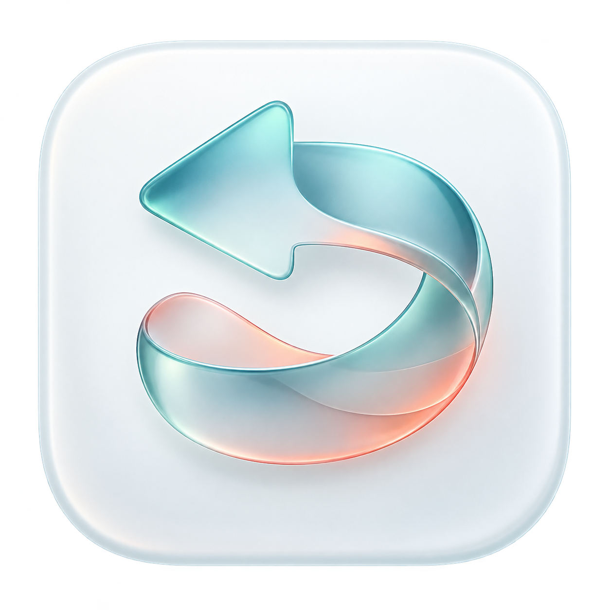

<p align="center"></p>

# Reprise

**Your screen history and meeting memories, searchable on your Mac.**

[한국어](README.ko.md) · [Download Alpha](https://github.com/hyungchulc/reprise/releases) · [MCP](docs/MCP.md) · [Privacy](docs/PRIVACY.md)

Reprise is a native macOS memory app with a full-screen timeline, local screen OCR,
meeting audio and transcripts, and AI answers linked to the original memories.
It is an independent implementation inspired by Rewind's workflow, not an official
Rewind product, fork, or compatible database reader.

> **Alpha software.** Back up important recordings. The first binary release is
> Apple Silicon only, development-signed, and **not Apple-notarized**. It is not a
> production-ready archival or compliance tool. macOS may block the initial launch.

## Install

1. Download the DMG or app ZIP from [Releases](https://github.com/hyungchulc/reprise/releases).
2. Move `Reprise.app` to `Applications` or `~/Applications`, then open that copy.
3. Complete onboarding. Grant screen recording permission only when you want screen
   capture; microphone and speech permissions are separate.
4. Choose a global shortcut and, optionally, connect an installed AI provider CLI.

Requires macOS 14 or later. Native Liquid Glass is used on macOS 26 or later;
older systems use material-based controls. macOS 14/15 compatibility is a source
target, not a completed device test matrix. The app UI is currently English.

For a Gatekeeper warning, review the release and verify its checksum before using
the normal **System Settings > Privacy & Security > Open Anyway** flow. Do not
disable Gatekeeper globally. A signing-identity change may require a fresh capture
permission and restart. Reprise never edits the system permission database.

### If macOS Cannot Verify The App

This alpha's Apple Development signature is **not Developer ID distribution
approval**. macOS may block the initial launch even when the archive checksum and
code signature are valid. The DMG contains the app and an Applications shortcut,
not a separate installer; the ZIP contains the same app.

**A failed copy or installation is a separate issue.** If the app cannot be moved
to your chosen Applications folder, report the exact alert and step. Open Anyway
is not a fix for a failed copy. Manual alpha.2 installation has since succeeded on
the maintainer's Mac, but the cause of an earlier interruption is still unconfirmed.
This does not establish compatibility on other Macs.

After copying succeeds and you attempt to open that copy, use **Open Anyway**
only if you trust this source and macOS offers it. This is a user-granted exception,
not a verified or notarized installation. If no exception is offered or the system
reports malware, stop and report the exact alert. Do not disable system protection
or remove quarantine attributes. See [Apple's guidance](https://support.apple.com/guide/mac-help/open-a-mac-app-from-an-unknown-developer-mh40616/mac).

Building the reviewed source locally is another development option. Free Apple
Accounts do not provide Developer ID distribution signing or notarization, which
require Apple Developer Program membership. This release does not claim a clean
downloaded-installation test on every supported macOS version.

## What It Does

| Area | Alpha functionality |
| --- | --- |
| Screen memory | Periodic ScreenCaptureKit still frames, on-device Vision OCR, local full-text index |
| Timeline | Full-screen overlay, app icons and icon-derived colors, calendar, compressed recording gaps, 30-second navigation |
| Search | Local keyword search, AI query planning, source-linked answers, follow-up questions, saved conversations |
| Meetings | Explicit microphone recording, optional system audio, post-recording on-device transcription in up to five languages at once, inline playback and timestamp seeking |
| AI providers | Codex, Claude and Grok through installed subscription CLIs; model selection and reported token usage |
| MCP | Opt-in read-only memory search for Claude Desktop, Claude Code, Codex, Cursor and compatible local clients |
| Appearance | System/custom accent, system/manual light and dark modes, text size, transitions and optional edge glow |
| Controls | Editable global shortcut, Dock/menu bar placement, launch options, pause reminders, exclusions and retention |
| Updates | Sparkle checks a signed feed and downloads signed archives from GitHub Releases |

The default shortcut is **Command + Shift + Space**. It opens focused search in
the memory overlay. Escape first collapses search, then closes the overlay.
Recent conversations restore saved answers and citations without another AI call.
Audio search results expand in place, and recordings have a waveform timeline lane.

Screen and audio recording are separate actions. Optional meeting detection offers
a prompt; it never starts recording automatically. Screen auto-start requires an
explicit setting. No sample library is created.

## AI Search

Install and sign in to a supported provider CLI separately. In **Settings > AI &
Models**, select the provider, model, and optionally an absolute executable path.
A blank model uses the current provider default. Reprise does not bundle the CLIs
or create API keys. An eligible subscription and compatible CLI are required;
authentication, availability and limits remain provider-controlled.

Search plans queries over the local FTS index, then supplies bounded OCR and
transcript evidence to the chosen provider. Focused answers use up to 24 memories;
activity summaries sample up to 96 representatives across the full filtered
interval. Answers link back to stored memories and show coverage. **Sampling and
excerpt limits can omit details; an answer is not an exhaustive account of a day.**

Provider subprocesses use explicit tool restrictions, isolated temporary settings,
timeouts and bounded output. Unsupported CLI contracts fail closed. These controls
reduce agent side effects; they are not a guarantee that a third-party executable
is trustworthy. Remaining subscription quota is shown as unknown when unavailable.
Apple Intelligence, Private Cloud Compute and direct API-key providers are not
implemented in this alpha. See [provider contracts](docs/PROVIDERS.md).

## MCP Connections

Open **Settings > MCP & Integrations**, enable memory access, and install a client
configuration. Restart the client after installation. Screenshot sharing is a
separate opt-in and is off by default. **Copy Configuration** supports other clients
with local stdio MCP support.

The bundled `RepriseMCP` helper searches the same vault without opening the UI or
running an additional model. It cannot record, delete or change memories. Connected
clients may send retrieved content to their own providers. Web-only clients that
require a remote HTTP server cannot connect directly. [Setup and tools](docs/MCP.md).

## Local Data And Resource Use

The default vault is `~/Library/Application Support/Reprise`. It is independent of
the app version and contains the database, images, audio, transcripts, search history
and usage. Since 0.6 the vault is **encrypted**: the database with SQLCipher and every
screenshot, movie and recording with AES-256-GCM. The key lives in your login keychain,
where only Reprise and its MCP helper can read it without asking. If any other app asks
macOS for “Reprise Vault Key”, deny it unless you started that request. Losing the
login keychain loses the vault, so keep the Mac's keychain in your backups.
[What encryption covers](docs/PRIVACY.md#encryption).
Reprise does not bundle any recorded memories or credentials in its releases.

Capture defaults to native Retina resolution, 85% image quality and a 3-second
interval. Settings expose smaller resolutions, intervals, retention and storage
limits. Unchanged-screen deduplication that ignores the menu bar's clock and live status
items, HEIC with JPEG fallback, separate 400px HEIC thumbnails, HEVC compression of
screens older than 15 minutes (roughly 4–7 times smaller in our samples), re-encoding at
half resolution after 7 days (adjustable or off in Settings), bounded capture/OCR work,
and 96 MB preview / 8 MB thumbnail caches
limit background work. These are implementation choices, not measured guarantees
against another app. CPU and process memory are visible; GPU usage is not measured.

Automatic transcription saves the recording first, then transcribes it on-device in
each chosen language and keeps, for every passage, the language that fits it best.
On macOS 26 and later, speech models download when a language is chosen. Failures remain visible
and the original audio is preserved. A recording can last at most four hours.
Title-based privacy and meeting detection are best-effort, not complete protection.
Review [data flow and limitations](docs/PRIVACY.md) before recording sensitive work.

## Updates

Use **Settings > General > Check for Updates** or the menu bar command. Automatic
checks are optional and off by default. Sparkle verifies both the update feed and
the archive with the pinned Ed25519 public key before extraction. Releases are
hosted on GitHub; installation waits for recording shutdown before relaunch.

Older local-only builds need one manual installation of this alpha. After that,
updates use GitHub. Updating does not replace the vault. Signing and macOS
permission behavior can still require user attention during alpha development.

## Build From Source

Use Xcode 26 or newer with the macOS 26 SDK and Swift Package Manager. The source
targets macOS 14+. Dependencies are pinned in `Package.resolved`.
Use `main` for the Swift toolchain compatibility fix made after the first alpha tag.

```sh
git clone https://github.com/hyungchulc/reprise.git
cd reprise
swift build
swift test --filter 'MCPTests|MomentStoreTests|MemorySearchTests'
./script/build_and_run.sh --build
```

The packaged result is `dist/Reprise.app`; building does not replace or restart an
installed copy. The script uses an available Apple Development identity, or an
explicit `REPRISE_SIGNING_IDENTITY`. For a disposable unsigned-development build:

```sh
REPRISE_SIGNING_IDENTITY=- REPRISE_ALLOW_ADHOC=1 ./script/build_and_run.sh --build
```

Ad-hoc builds can lose capture permission across rebuilds. Forks must replace the
update feed and public key before distribution. [Release procedure](docs/RELEASING.md).

## Development And Reporting

The app uses SwiftUI/AppKit, ScreenCaptureKit, Vision, Speech, AVFoundation, SQLCipher
FTS5, the official MCP Swift SDK, and Sparkle. There is no bundled LLM, vector
database or always-running inference service. [Architecture](docs/ARCHITECTURE.md).

Report reproducible problems through [Issues](https://github.com/hyungchulc/reprise/issues).
Include macOS/app versions and steps, but **never upload your vault, raw recordings,
tokens, personal screenshots or unredacted transcripts**. See [security reporting](SECURITY.md).
Third-party licenses are in [THIRD_PARTY_NOTICES.md](THIRD_PARTY_NOTICES.md).

## License

Reprise's original code and assets are available under the [MIT License](LICENSE).
Third-party components retain their own licenses. No Rewind binaries, extracted
assets or recorded user data are included.
